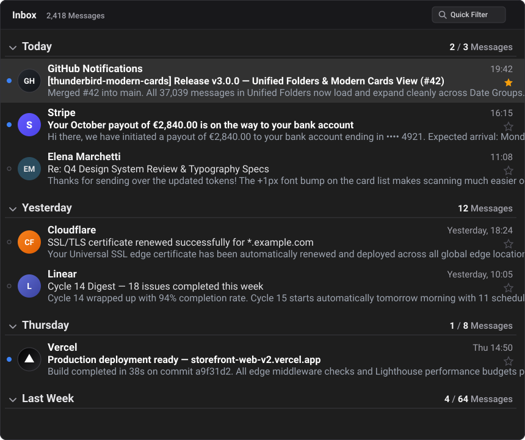

# Thunderbird Modern Cards View

A permanent, update-proof customization and extension for **Mozilla Thunderbird (128+ / 136+ / 158+)** that upgrades the Cards View message list with a clean flat layout, detailed Date Group headers, 1-line message body previews, and automatic sender profile pictures.

---

## ✨ Features

1. **Flat, Borderless Cards View**
   - Clean, transparent cards with flush spacing and subtle hover/selection highlights (supports both Light and Dark themes via `light-dark()`).
2. **Larger Date Group Headers with Bottom Border & Right-Aligned Counters**
   - Bold group header titles (`Today`, `Yesterday`, etc.) with a `1px solid` bottom border line.
   - Left-aligned expand/collapse chevron and right-aligned `Unread / Total` message counter on the same horizontal row.
3. **Detailed Date Group Buckets**
   - Automatically groups messages (in both single folders and **Unified Folders**) into:
     - `Today`
     - `Yesterday`
     - Earlier days of the current week (`Friday`, `Thursday`, `Wednesday`, `Tuesday`, `Monday`)
     - `Last Week`
     - `Two Weeks Ago`
     - `Older`
4. **1-Line Message Body Preview Beneath Subject**
   - Extracts clean plain-text snippets from message bodies (stripping HTML, CSS, and invisible tracking characters) and renders a 1-line preview directly beneath the Subject line.
5. **Auto Profile Pictures in Message List & Reading Pane**
   - Displays circular sender avatars (BIMI, Gravatar, DuckDuckGo company logos, Libravatar, IconHorse, Address Book photos) with an instant, zero-flicker colored initials fallback.
   - **Update-Proof**: Configured with `"strict_max_version": "*"`, `applyBackgroundUpdates: 0`, and `extensions.strictCompatibility = false` so Thunderbird updates never disable or overwrite it.

---

## 🚀 Quick Installation

### Option A: 1-Click Automatic Installer (Windows / macOS / Linux)
1. Clone or download this repository.
2. Run the installer:
   - **Windows**: Double-click **`install_to_thunderbird.bat`** (or run `python install_to_thunderbird.py`)
   - **macOS / Linux**: Run `python3 install_to_thunderbird.py`
3. Start Thunderbird!

*(To target a specific profile directory, run `python install_to_thunderbird.py --profile /path/to/profile`.)*

### Option B: Manual Installation via Thunderbird Add-ons Manager
1. Copy `user.js` and `chrome/userChrome.css` into your Thunderbird profile folder.
2. In Thunderbird, open **Add-ons and Themes (`Ctrl+Shift+A`)** → click the **Gear icon (⚙️)** → **Install Add-on From File...** and select:
   - `dist/modern-cards-view@thunderbird.addon.xpi` (standalone install), or
   - `dist/autoprofilepicture@astucesweb.fr.xpi` (drop-in replacement if migrating from Auto Profile Picture to preserve your existing IndexedDB avatar cache).

---

## 📁 Repository Structure

- `assets/preview.svg` — Visual preview of the Thunderbird Modern Cards View message list.
- `dist/modern-cards-view@thunderbird.addon.xpi` — Standalone extension `.xpi` package.
- `dist/autoprofilepicture@astucesweb.fr.xpi` — Drop-in replacement `.xpi` package (preserves existing Auto Profile Picture IndexedDB cache).
- `chrome/userChrome.css` — Profile stylesheet (also embedded inside the `.xpi` extension for 100% portability).
- `user.js` — Persistent Thunderbird preferences (`3`-row card height, default grouped-by-date view flags, and permanent extension compatibility settings).
- `src/` — Full unpacked source code of the extension (`manifest.json`, `api/headerApi.js`, `background.js`, etc.).
- `install_to_thunderbird.py` / `install_to_thunderbird.bat` — Cross-platform builder and profile installer.

---

## 📜 Credits & License

- Avatar fetching engine based on [Auto Profile Picture](https://astucesweb.fr/projets/auto-profile-picture/) by **Noam SCHMITT**.
- Licensed under the **Mozilla Public License 2.0 (MPL-2.0)** — see [`LICENSE`](LICENSE) and [`src/NOTICE`](src/NOTICE).
